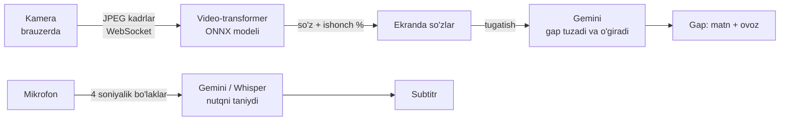
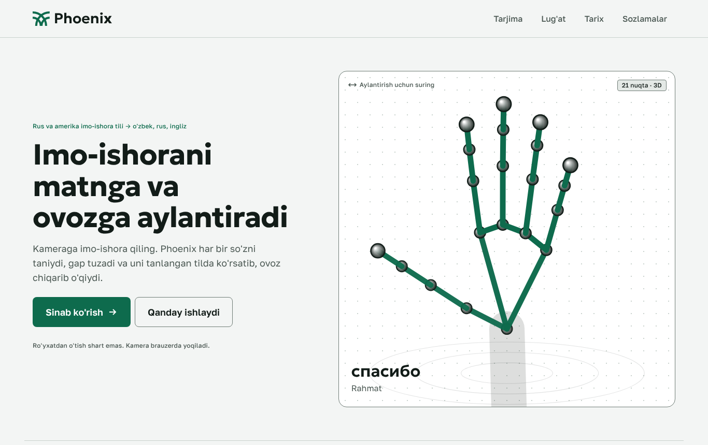
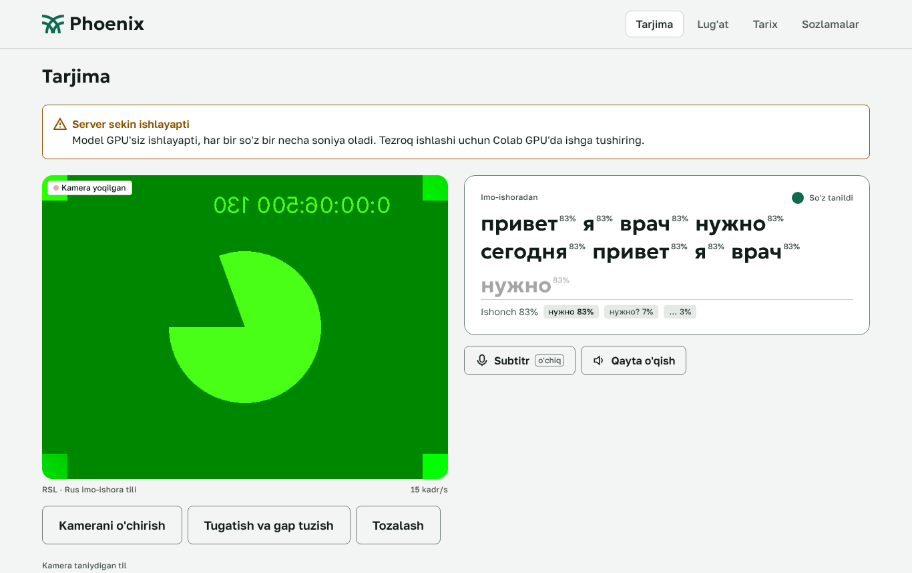

# Phoenix: imo-ishora tarjimoni

Phoenix kar va eshitmaydigan odamlar bilan eshitadigan odamlar o'rtasidagi suhbatni osonlashtiradigan veb-ilova. U kamera orqali imo-ishora tilini taniydi, tanilgan so'zlardan to'liq gap tuzadi va uni o'zbek, rus yoki ingliz tilida matn va ovoz qilib beradi. Javob tomonda eshituvchining nutqi subtitr bo'lib ekranga chiqadi.

> Xakaton loyihasi (1 haftalik MVP). Hozir rus imo-ishora tili (RSL) va amerika imo-ishora tili (ASL) taniladi. O'zbek imo-ishora tili uchun ochiq ma'lumotlar to'plami yo'q, shuning uchun o'zbek tili hozircha **natija tili** sifatida ishlaydi.

## Mundarija

1. [Loyiha nima qiladi](#loyiha-nima-qiladi)
2. [Qanday ishlaydi](#qanday-ishlaydi)
3. [Texnologiyalar](#texnologiyalar)
4. [Repo tuzilishi](#repo-tuzilishi)
5. [Ishga tushirish](#ishga-tushirish)
6. [Testlar](#testlar)
7. [Natijalar va cheklovlar](#natijalar-va-cheklovlar)
8. [Ishlar davomida](#ishlar-davomida)
9. [Hujjatlar](#hujjatlar)
10. [Litsenziyalar](#litsenziyalar)

## Loyiha nima qiladi

| Imkoniyat | Tavsif |
| --- | --- |
| Imo-ishoradan matnga | Kamera oldida imo-ishora qilinadi, har bir tanilgan so'z ishonch foizi va muqobil variantlari bilan ekranga chiqadi. |
| So'zlardan gap | Imo-ishora tilida grammatika boshqacha. Tanilgan so'zlar ("men", "shifokor", "kerak") Gemini yordamida odatdagi gapga aylanadi va tanlangan tilga o'giriladi. |
| Ovoz | Tayyor gap brauzer ovozi bilan o'qib beriladi. |
| Nutqdan subtitr | Eshituvchi gapiradi, uning gapi matn bo'lib chiqadi (Gemini yoki Whisper). |
| Lug'at | Tizim taniydigan 3000 ta imo-ishorani qidirish (1000 RSL + 2000 ASL). |
| Tarix | Oldingi tarjimalar. Login yo'q: har bir brauzer o'z tasodifiy identifikatoriga ega. |
| Ma'lumot yig'ish | Foydalanuvchi roziligi bilan imo-ishora videosini yuborish (kelajakda o'zbek imo-ishora tili uchun). |

## Qanday ishlaydi



1. **Kamera.** Brauzer sekundiga 15 ta kichik kadrni (384×288 JPEG) WebSocket orqali serverga yuboradi.
2. **Tanish.** Server oxirgi 32 kadrni (taxminan 2 soniya) video-transformer modeliga beradi. Model eng ehtimolli so'zni va 3 ta muqobilini qaytaradi. Ishonch 50% dan past bo'lsa, natija tashlab yuboriladi.
3. **Gap.** Foydalanuvchi "Tugatish" tugmasini bosganda, tanilgan so'zlar ro'yxati Gemini'ga yuboriladi va u tabiiy gap qaytaradi. Gemini ishlamasa, so'zlar o'zicha ko'rsatiladi.
4. **Natija.** Gap ekranga chiqadi va ovoz chiqarib o'qiladi. Eshituvchining javobi mikrofon orqali subtitrga aylanadi.

## Texnologiyalar

| Qatlam | Texnologiya | Nima uchun tanlangan |
| --- | --- | --- |
| Sayt (frontend) | HTML, CSS, JavaScript (ES modullar), build bosqichisiz | Har qanday kompyuterda ochiladi, o'rnatish kerak emas, kodni o'qish oson |
| Dizayn tizimi | O'z ranglar, shriftlar (Golos Text, Geologica), komponentlar: [`frontend-resources/`](frontend-resources/README.md) | Bir xil ko'rinish, yorug' va qorong'i mavzu |
| Server (backend) | Python 3.11+, FastAPI, Uvicorn | Tez, asinxron, WebSocket'ni qo'llab-quvvatlaydi, avtomatik API hujjati (`/docs`) |
| Imo-ishora modeli (RSL) | Slovo MViTv2 (`mvit32-2`), ONNX Runtime | 1000 ta rus imo-ishorasiga o'qitilgan ochiq model |
| Imo-ishora modeli (ASL) | SignFlow-A (WLASL-2000), ONNX Runtime | 2000 ta ingliz (ASL) so'zi, faqat notijorat foydalanish uchun |
| Gap tuzish va tarjima | Google Gemini API | So'zlar ro'yxatidan grammatik to'g'ri o'zbekcha gap |
| Nutqni tanish | Gemini (asosiy), faster-whisper (zaxira) | Gemini o'zbek tilini yaxshiroq taniydi, Whisper internetsiz ham ishlaydi |
| Ovoz chiqarish | Brauzerning `speechSynthesis` funksiyasi | Serverga yuk yo'q, bepul |
| Ma'lumotlar bazasi | SQLite (demo) yoki PostgreSQL 16 | Lug'at, tarix, yuborilgan videolar |
| GPU | Google Colab bepul T4 GPU + Cloudflare tunnel | Pullik server shart emas, bitta havola orqali ishlaydi |
| Joylashtirish | Docker, Docker Compose | Bitta buyruq bilan server va baza |
| Testlar | pytest, Playwright (qo'lda tekshiruv) | 108 ta avtomatik test, haqiqiy modelsiz ishlaydi |

## Repo tuzilishi

```
PROJECT-PHEONIX/
├── frontend/              Sayt: foydalanuvchi ko'radigan hamma narsa
│   ├── index.html         Barcha sahifalar (bosh sahifa, tarjima, lug'at, tarix, sozlamalar)
│   ├── css/app.css        Dizayn: ranglar, shriftlar, animatsiya
│   ├── js/                Mantiq: har bir sahifa alohida faylda
│   │   ├── main.js        Sahifalar orasida o'tish, kirish animatsiyasi
│   │   ├── translate.js   Kamera, WebSocket, subtitr, ovoz
│   │   ├── learn.js       Lug'at va video yuborish
│   │   ├── history.js     Tarix
│   │   ├── api.js         Server bilan aloqa
│   │   ├── settings.js    Sozlamalar (brauzerda saqlanadi)
│   │   ├── i18n.js        Uch til: o'zbek, rus, ingliz
│   │   └── hero-hands.js  Bosh sahifadagi "xush kelibsiz" 3D qo'llar
│   ├── fonts/             Shriftlar (SIL OFL litsenziyasi)
│   ├── vendor/three/      three.js (3D uchun, MIT)
│   └── assets/            Logo, 3D qo'l modellari, demo video joyi (real.mp4)
├── backend/               Server: imo-ishorani taniydigan Python kodi
│   ├── app/               FastAPI ilovasi
│   │   ├── sign/          Imo-ishorani tanish (model, kadrlar oqimi, WebSocket)
│   │   ├── stt/           Nutqni matnga aylantirish
│   │   ├── llm/           Gemini: so'zlardan gap
│   │   └── api/           Lug'at, tarix, video yuborish, salomatlik tekshiruvi
│   ├── tests/             Avtomatik testlar
│   ├── scripts/           Modellarni yuklab olish, GPU tezligini o'lchash, sinov
│   ├── config/            Qaysi til qaysi modelni ishlatishi
│   ├── data/              Imo-ishoralar ro'yxati (RSL 1000, ASL 2000)
│   └── Dockerfile
├── deploy/                Google Colab'da bepul GPU bilan ishga tushirish
├── docs/                  API hujjati, reja va ish jarayoni rasmlari (docs/progress/)
├── frontend-resources/    Dizayn tizimi: ranglar, shriftlar, logotip, komponentlar
├── tools/motion-video/    Bosh sahifadagi demo videoning manbasi (kodda chizilgan, 120 fps)
├── docker-compose.yml     Server + PostgreSQL bitta buyruqda
└── CHANGELOG.md           O'zgarishlar tarixi
```

## Ishga tushirish

### 1-usul: Google Colab (eng oson, GPU bepul)

1. [`deploy/phoenix_colab.ipynb`](deploy/phoenix_colab.ipynb) faylini Google Colab'da oching.
2. `Runtime > Change runtime type > T4 GPU` ni tanlang.
3. `Runtime > Run all` ni bosing. Taxminan 10 daqiqadan keyin ekranda **Website** havolasi chiqadi. Shu havolani oching.

Batafsil: [`deploy/COLAB.md`](deploy/COLAB.md).

### 2-usul: O'z kompyuterida

Python 3.11 yoki undan yangi versiyasi kerak.

```bash
cd backend
python -m venv .venv && .venv/bin/pip install -e '.[dev]'
./scripts/download_models.sh      # modellar (~300 MB), internet kerak
cp .env.example .env              # Gemini kalitini shu faylga yozing (ixtiyoriy)
.venv/bin/uvicorn app.main:app
```

Keyin brauzerda http://localhost:8000 ni oching. Sayt va server bitta manzilda ishlaydi. API hujjati: http://localhost:8000/docs

> Kompyuter protsessorida (GPU'siz) har bir so'zni tanish taxminan 8 soniya oladi. Jonli tarjima uchun GPU kerak (1-usul).

### 3-usul: Docker

```bash
docker compose up --build
```

Server va PostgreSQL bazasi ishga tushadi, modellar birinchi ishga tushishda yuklab olinadi. Sayt: http://localhost:8000

### 4-usul: Serversiz namoyish (GPU yo'q bo'lsa)

```bash
cd frontend
python3 -m http.server 8080
```

Brauzerda http://localhost:8080 ni oching. Server topilmasa, sayt o'zi **namoyish rejimi**ga o'tadi: hamma sahifalar ishlaydi, lekin so'zlar namuna ketma-ketligidan chiqadi va ekranda "Namoyish rejimi" deb yozib turadi. Haqiqiy tanish uchun server kerak (1-3-usullar).

### Ikki rejim

| Rejim | Qachon | Nima bo'ladi |
| --- | --- | --- |
| Jonli | Server javob bersa (sayt serverning o'zida ochilgan yoki Sozlamalarda server manzili berilgan) | Kamera kadrlari serverga boradi, model haqiqiy imo-ishorani taniydi |
| Namoyish | Server javob bermasa (standart holat) | O'sha interfeys, lekin so'zlar, gaplar va subtitrlar namuna. Hech narsa brauzerdan chiqmaydi |

Rejimni **Sozlamalar > Ish rejimi** dan qo'lda ham tanlash mumkin.

### Saytni boshqa serverga ulash

Sayt odatda o'zi ochilgan serverga ulanadi. Boshqa serverni ishlatish uchun saytdagi **Sozlamalar > Server manzili** maydoniga havolani yozing yoki manzil satriga `?api=https://...` qo'shing.

## Testlar

```bash
cd backend
.venv/bin/pytest
```

108 ta test haqiqiy modellar va internetsiz ishlaydi: kichik soxta model, SQLite va soxta nutq tanish ishlatiladi. Ular WebSocket oqimini, xatolarni, tarixni, lug'atni, nutqni tanishni, Gemini'ni va saytni berishni tekshiradi.

## Natijalar va cheklovlar

**O'lchangan natijalar** (kichik sinov to'plamida, shuning uchun taxminiy):

| Model | Birinchi taxmin to'g'ri (top-1) | To'g'ri javob dastlabki variantlar ichida |
| --- | --- | --- |
| ASL (SignFlow-A) | 74% (34 ta videodan 25 tasi) | 100% (top-5) |
| RSL (Slovo mvit32-2) | 65% | 88% (top-4) |

Tezlik: noutbuk protsessorida bitta so'z taxminan 8 soniya. Colab T4 GPU'da tezlik notebookning 7a qadamida o'lchanadi.

**Cheklovlar:**

- Model alohida so'zlarni taniydi, uzluksiz imo-ishora nutqini emas. So'zlar orasida qisqa to'xtash kerak.
- O'zbek imo-ishora tili hali tanilmaydi (ochiq ma'lumotlar to'plami yo'q). Saytdagi video yuborish bo'limi shunday to'plam yig'ishni boshlash uchun.
- ASL modeli WLASL ma'lumotlari asosida, faqat notijorat (namoyish) maqsadda ishlatiladi.
- Gemini ishlatilganda ovoz va so'zlar Google serverlariga yuboriladi. Sayt buni foydalanuvchiga ko'rsatadi.
- Login yo'q: tarix brauzerga bog'langan, brauzer ma'lumotlari tozalansa, yo'qoladi.

## Ishlar davomida

Loyiha qanday rivojlangani rasmlarda: dizayn izlanishlari, Colab GPU va tayyor sayt. Hammasi: [`docs/progress/`](docs/progress/README.md).

| | |
| --- | --- |
|  |  |
| Bosh sahifa | Jonli tarjima (lokal sinov: sinov kamerasi va sinov modeli) |

## Hujjatlar

| Hujjat | Kim uchun |
| --- | --- |
| [`docs/API.md`](docs/API.md) | Server API: har bir so'rov va javob (inglizcha) |
| [`backend/README.md`](backend/README.md) | Server sozlamalari va texnik tafsilotlar (inglizcha) |
| [`frontend/README.md`](frontend/README.md) | Sayt kodi qanday tuzilgan |
| [`frontend-resources/README.md`](frontend-resources/README.md) | Dizayn qoidalari |
| [`deploy/COLAB.md`](deploy/COLAB.md) | Colab'da ishga tushirish |
| [`CHANGELOG.md`](CHANGELOG.md) | O'zgarishlar tarixi |

## Litsenziyalar

- Slovo ma'lumotlar to'plami va rus modellari: CC BY-SA 4.0, © ai-forever (Kapitanov va boshq., "Slovo: Russian Sign Language Dataset", 2023).
- ASL modeli (SignFlow-A) WLASL asosida: faqat notijorat foydalanish (C-UDA).
- Whisper: MIT.
- Shriftlar Golos Text va Geologica: SIL Open Font License 1.1.
