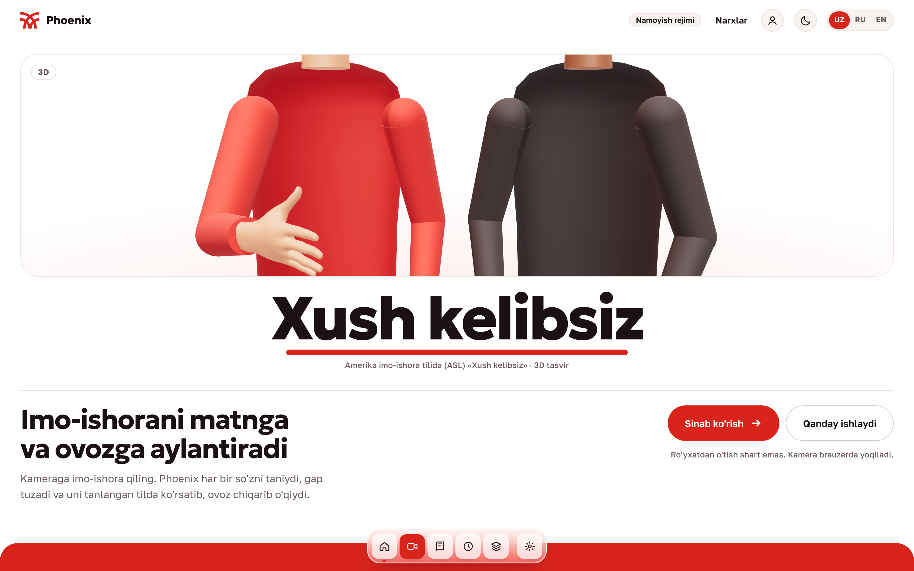
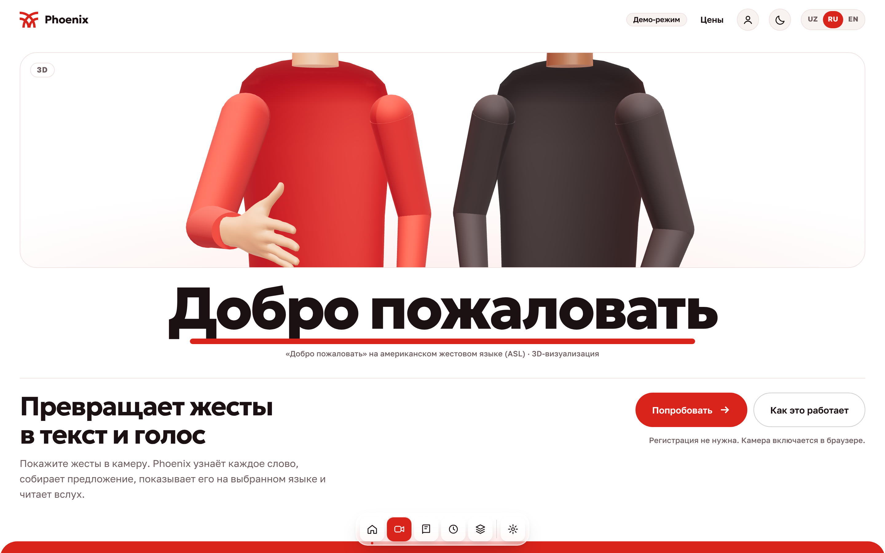
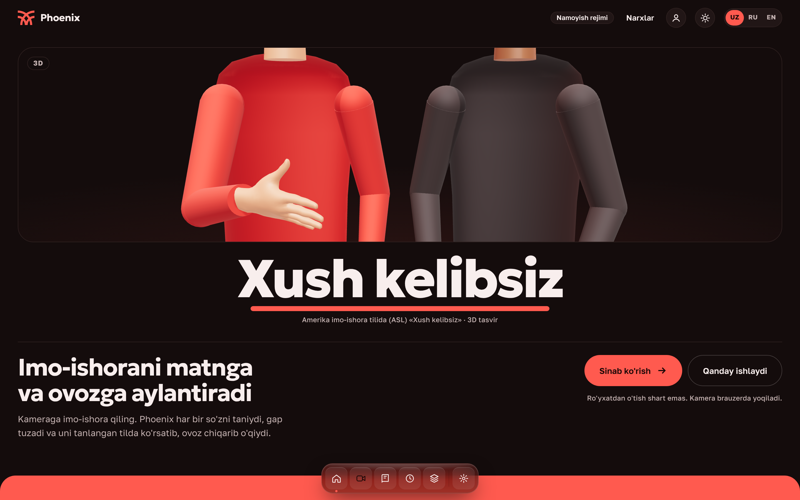
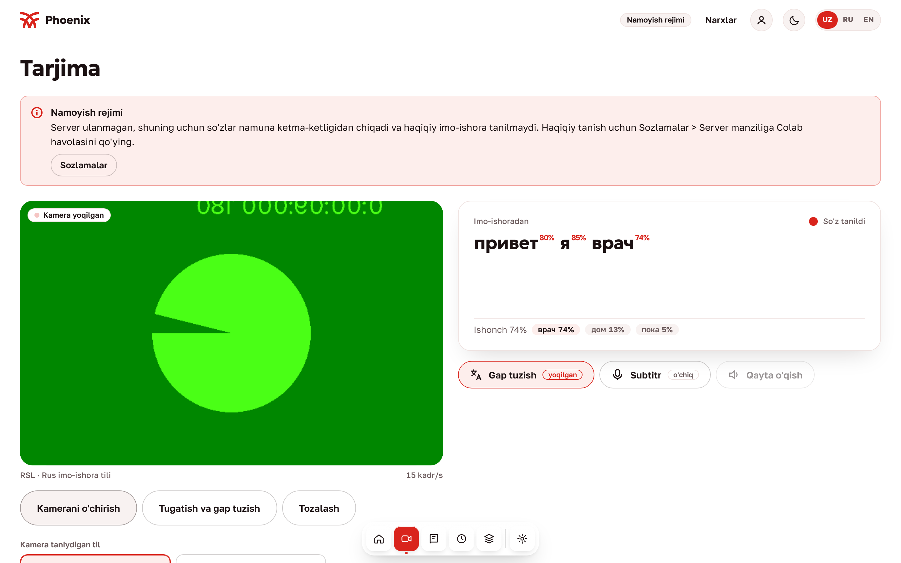
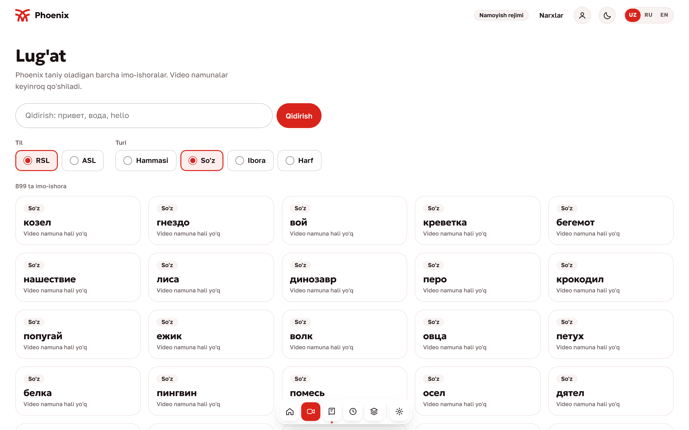
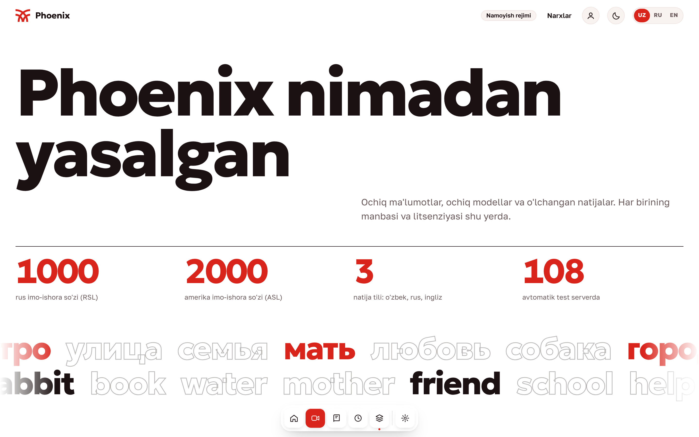
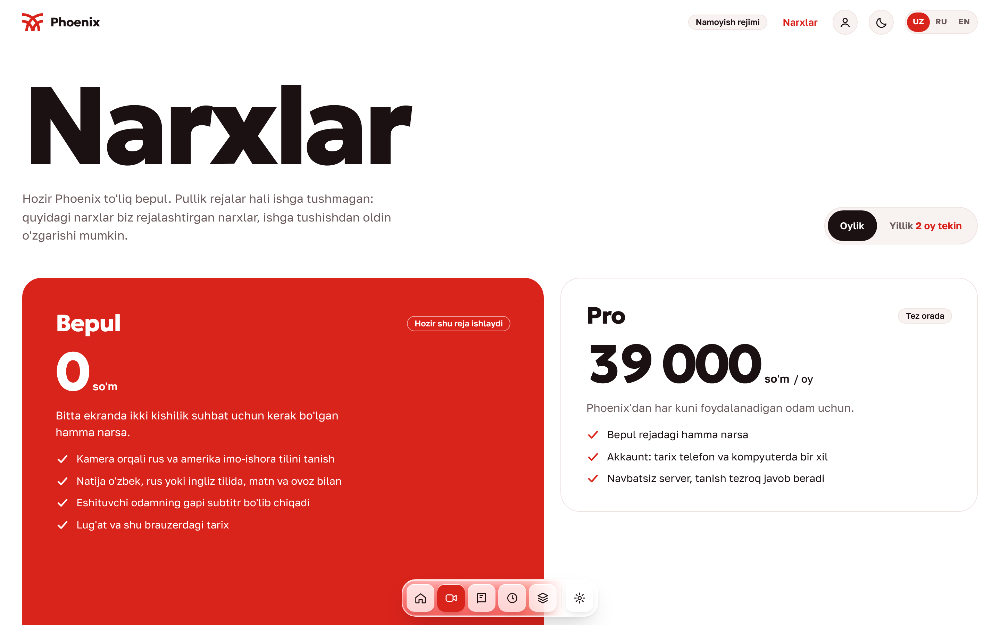
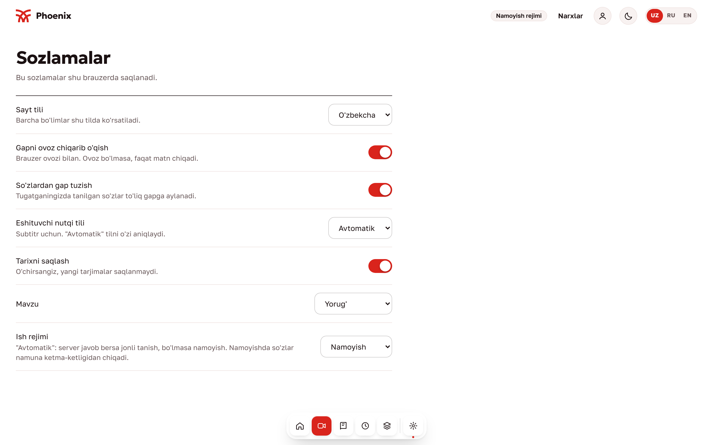
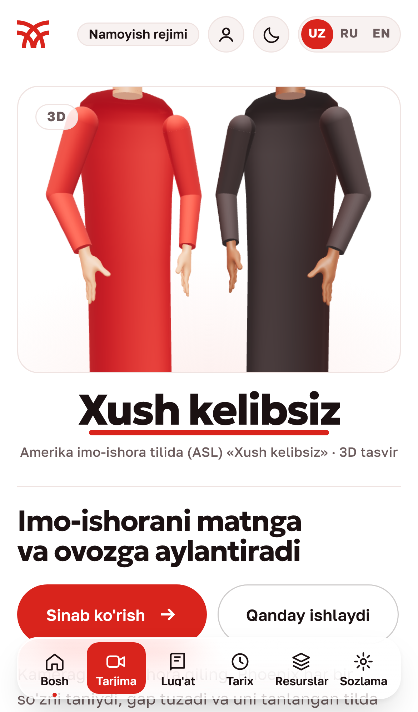

# Sayt rasmlari

Hozirgi sayt (`frontend/`, main). Kompyuter ekrani 1440×900, tiniq 2x. Namoyish rejimida (serversiz) olingan, shuning uchun so'zlar namuna ketma-ketligidan chiqadi. Tarjima rasmida kamera o'rnida brauzerning sinov tasviri (yashil fon).

| | |
| --- | --- |
|  Bosh sahifa |  Til RU |
|  Qorong'i mavzu |  Tarjima |
|  Lug'at |  Resurslar |
|  Narxlar |  Sozlamalar |
|  Telefonda (iPhone 13) | |

Eski versiyalar rasmlari tarix sifatida [`docs/progress/`](../progress/README.md) da qoldi.
